# FLOW — how FlowGuard actually runs

This file shows the project **running**, not just described. Two complete examples are traced step by step:
what you click, what each role sees, and what happens inside the system. Every number below comes from a real
run (`scripts/record_flow.py` → raw output in [docs/flow_trace.md](docs/flow_trace.md)). The screenshots were
taken by the automated browser tests in `frontend/e2e/`.

> Everything is fictional: Plant X, customers, routes, trucks and money. Times are simulated (the demo day
> starts 16 Nov 2026, 06:00 IST) and shown in IST.

---

## 0. The big picture

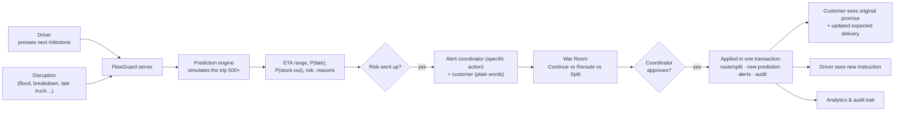

**The one-sentence version:** something happens → FlowGuard re-predicts → if risk rises it warns everyone →
the coordinator compares options in the War Room → a human approves → every role's screen updates.

### Who uses which window

| Window | Login | Sees |
| --- | --- | --- |
| Coordinator | `coordinator` | Control Tower, shipment details, War Room, Analytics, **Demo guide** |
| Customer | `customer_a` (Example 1) / `customer_c` (Example 2) | Only their own orders: promise, updated expected delivery, risk level, map |
| Driver | `driver1` (Example 1) / `relief_tr1` (Example 2) | Only their assigned truck: one "confirm next step" button |

Password for every account: `PlantX-demo-2026`. Each browser window keeps its own login.

---

## 1. Start the system

```bash
cd backend
.venv\Scripts\python -m uvicorn app.main:app --port 8000 --workers 1
```

Open http://127.0.0.1:8000 → log in as **coordinator** → click **Demo guide** in the top menu.

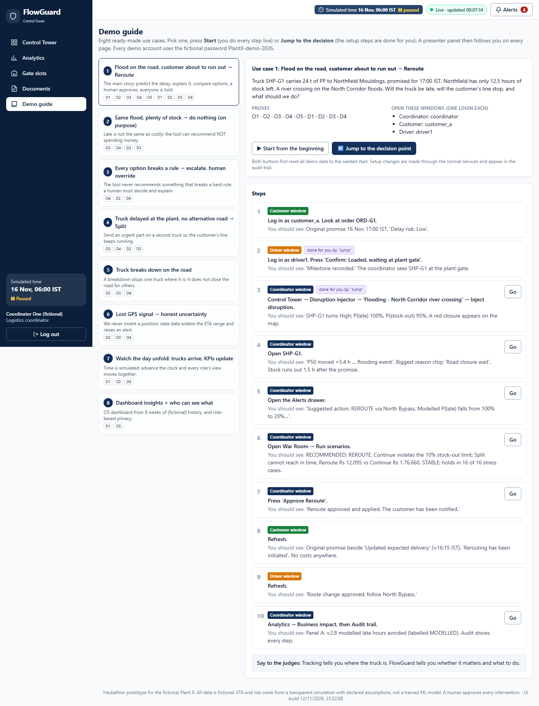

The Demo guide lists 8 use cases. Each has two buttons:

| Button | What it does |
| --- | --- |
| **▶ Start from the beginning** | Resets all demo data. You perform every step live |
| **⏩ Jump to the decision point** | Resets, then performs the setup steps for you (driver milestone, disruption, …) using the same code as the real buttons. Saves time when the clock is short |

After pressing either, a **presenter panel** follows you on every page, showing the NEXT step, which window
to use, what you should see, and a **Go** button.

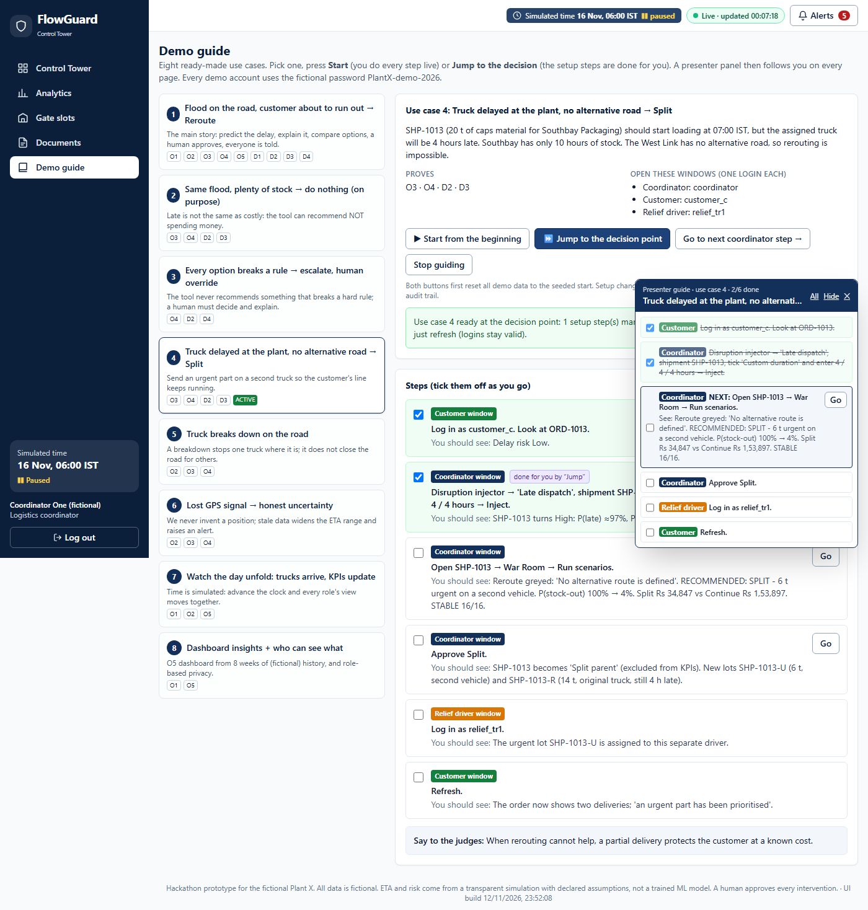

---

## 2. Example 1 — flood + customer about to run out → **Reroute**

*Demo guide → use case 1.* Shows all five official requirements.

**The situation.** Truck **SHP-G1** carries 24 t of PP from Plant X to Northfield Mouldings on the North
Corridor. Promised by **17:00 IST**. Northfield's stock runs out at **18:30 IST**.

### Step 1 — Before anything goes wrong

| Window | What you see |
| --- | --- |
| Customer (`customer_a`) | ORD-G1 "Being prepared at Plant X", original promise **16 Nov 17:00**, updated expected delivery **14:44**, delay risk **Low** |
| Coordinator | SHP-G1 "Loading at Plant X": risk **LOW** (index 0), P(late) **1%**, P(stock-out) **0%**, ETA 14:44 (likely 13:43 – 15:49) |

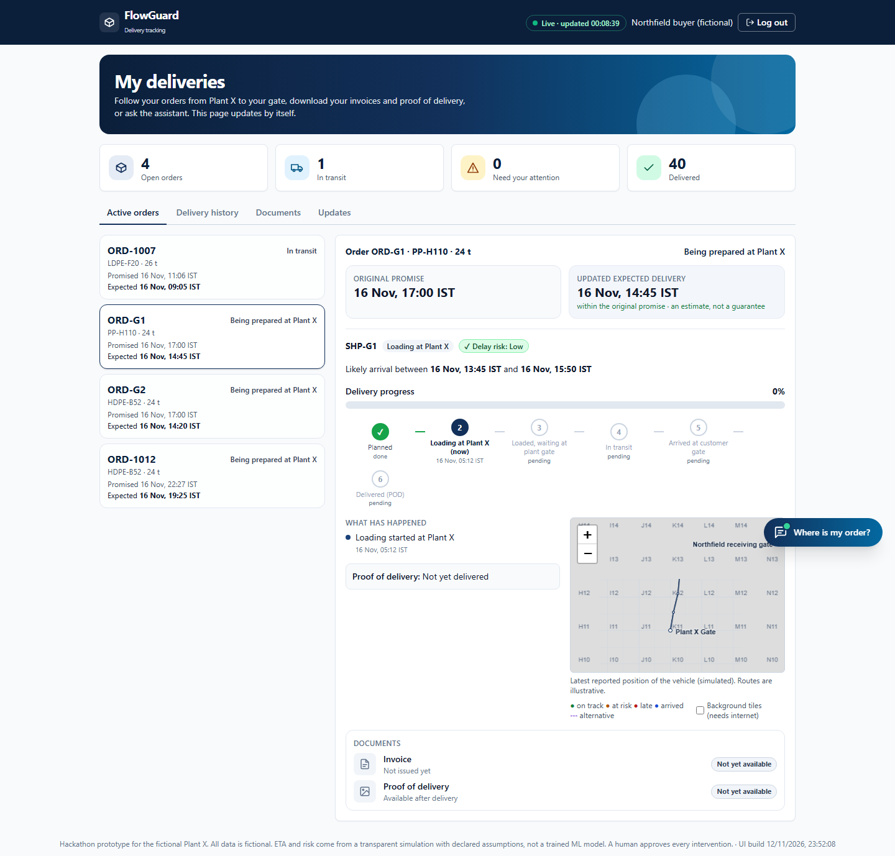

*Behind the scenes:* the engine simulated the rest of the trip 500 times (remaining loading, gate queue, each
road segment with random-but-realistic speed). 99% of simulated trips arrive before 17:00.

### Step 2 — The driver reports progress

Driver window (`driver1`) → **Confirm: Loaded, waiting at plant gate** → "Milestone recorded."

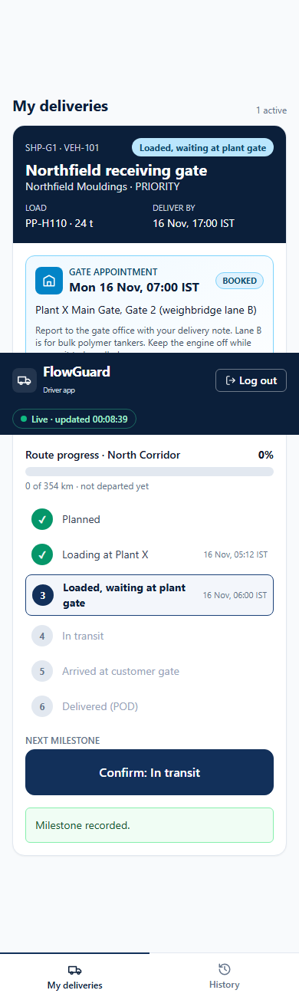

*Behind the scenes:* `POST /api/transporter/shipments/SHP-G1/milestones`. The server checks this is the
driver's own truck, that it is the **next** state only, and not in the future. It writes an event, bumps the
shipment's version number, recalculates the prediction and writes an audit row.

### Step 3 — A flood closes the road

Coordinator → Control Tower → Simulation controls → **Flooding – North Corridor river crossing** → Inject.
(Closure expected to last 7–12 h.)

| | Before | After the flood |
| --- | --- | --- |
| Risk | LOW (0) | **HIGH (98)** |
| P(late) | 1% | **100%** |
| P(stock-out) | 0% | **95%** |
| ETA (P50) | 14:44 | **19:54** (likely 18:27 – 21:27) |

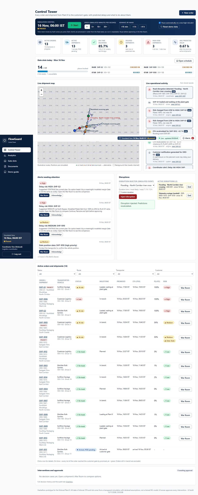

### Step 4 — Why? (O3: "show the reason")

Open SHP-G1:

- **"P50 moved +5.4 h: flooding event DSR-001"** — the change is pinned to the exact event.
- Reason chips (average hours added vs an undisturbed trip): **Road closure wait +5.45 h**, plant gate queue
  +0.57 h, travel variability +0.05 h. They add up exactly to the delay.

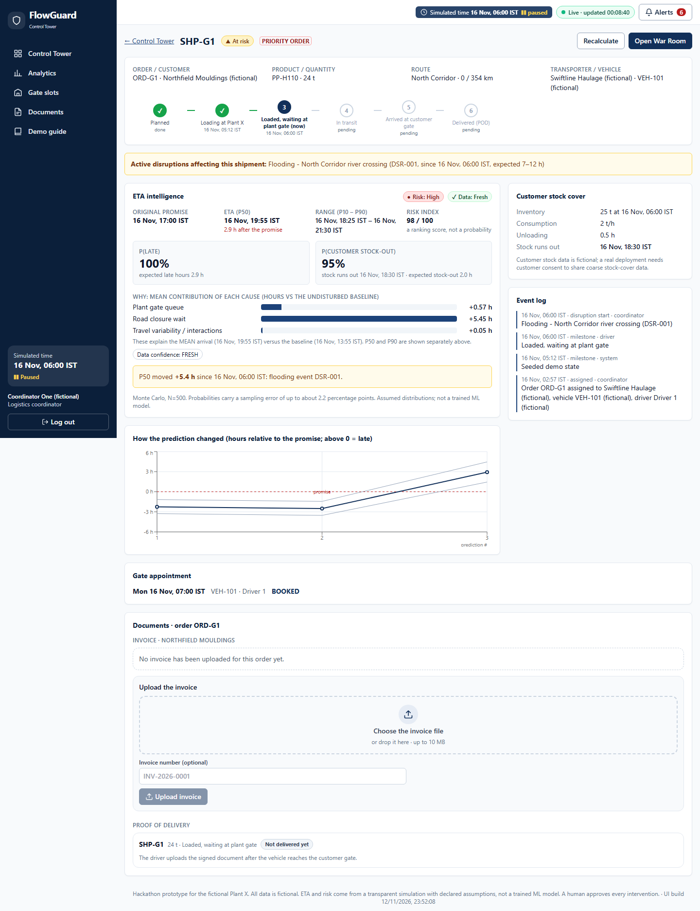

### Step 5 — Everyone is warned (O4)

| Who | Message |
| --- | --- |
| Coordinator (HIGH alert) | "P(late) 100%, P(stock-out) 95%, risk index 98. Main driver: road closure wait +5.5 h." **Suggested action: REROUTE via North Bypass.** Modelled P(late) falls from 100% to 20% for Rs 8,131 extra freight. |
| Customer | "A road closure on the planned route may delay your delivery. Our logistics team is **evaluating** an alternate route; no action is required from you." |

Note the customer gets **no costs and no probabilities**, and the message says "evaluating", because nothing
has been approved yet.

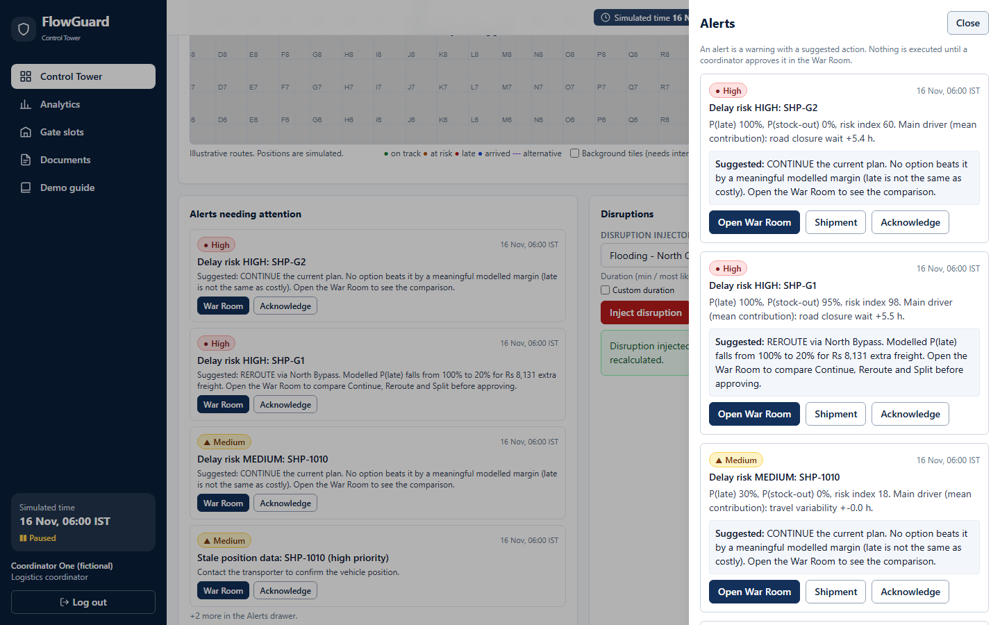

### Step 6 — The War Room compares the options

Alerts → **Open War Room** → **Run scenarios**. All three options use the *same* 500 simulated futures, so the
comparison is fair.

| Option | Feasible | ETA (P50) | P(late) | P(stock-out) | Extra freight | SLA penalty | Stock-out cost | **Expected total** |
| --- | --- | --- | --- | --- | --- | --- | --- | --- |
| Continue | ✕ | 19:54 | 100% | 95% | Rs 0 | Rs 58,908 | Rs 1,17,752 | **Rs 1,76,660** |
| **Reroute** | ✓ | 16:14 | 20% | 4% | Rs 8,131 | Rs 2,560 | Rs 1,404 | **Rs 12,095** |
| Split | ✕ | 19:57 | 100% | 76% | Rs 40,626 | Rs 51,498 | Rs 50,427 | **Rs 1,42,551** |

**RECOMMENDED: REROUTE** · **STABLE (holds in 16 of 16 stress cases)**

Why the others lose:
- Continue breaks the hard rule *P(stock-out) ≤ 10%* (it is 95%).
- Split: the second truck can't load and arrive before the stock runs out (only 22% chance, rule needs 90%).

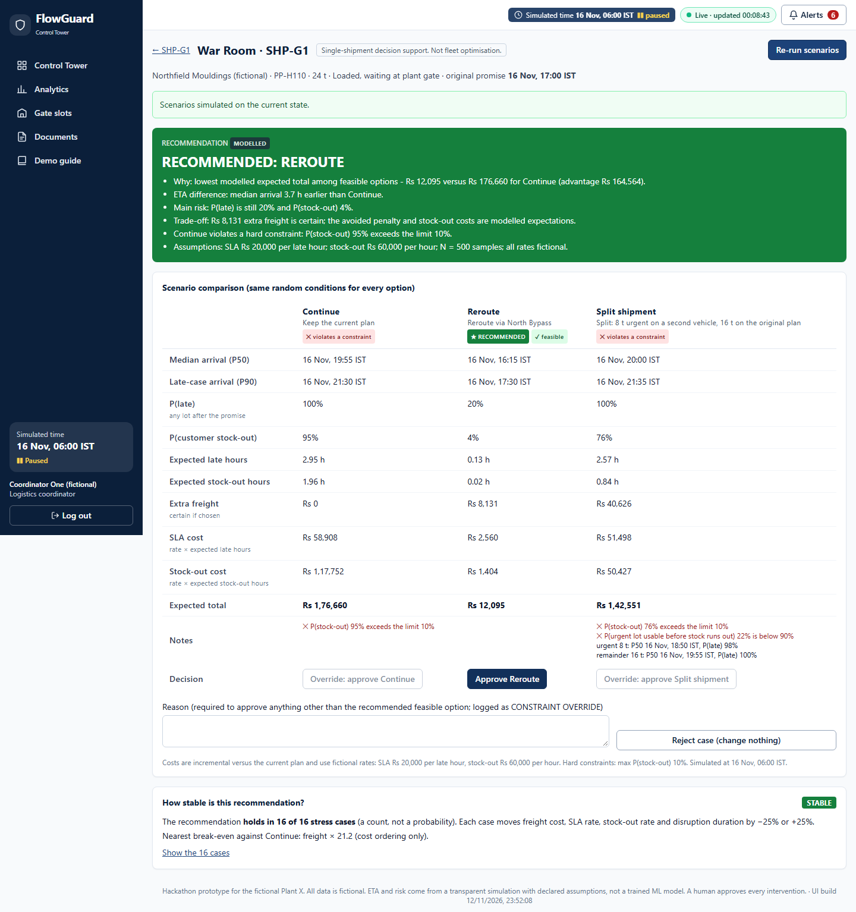

### Step 7 — A human approves

**Approve Reroute** → case **APPLIED**. In one database transaction the server:

1. switches SHP-G1 to the North Bypass,
2. writes an event and a fresh prediction (now **LOW**, P(late) 20%, ETA **16:14**),
3. notifies the customer and the coordinator,
4. records the decision in the audit trail with the modelled impact: **2.82 late hours avoided**,
   **Rs 1,64,564 modelled cost difference**, Rs 8,131 extra freight.

*Safety check:* if the shipment, the assumptions or the clock had changed after "Run scenarios", the approval
would be refused (HTTP 409, "out of date, re-run").

### Step 8 — Every role sees the result

| Window | What changed |
| --- | --- |
| Customer | Original promise **17:00** beside updated expected delivery **16:14**. "Your delivery has been rerouted to protect the delivery time." Alert: "Rerouting has been **initiated**…" |
| Driver | "Route change approved: follow North Bypass." |
| Coordinator → Analytics → Business impact | Panel A: modelled hours avoided and cost difference, labelled **MODELLED** |
| Coordinator → Analytics → Audit trail | `DEMO_SETUP → MILESTONE_POSTED → DISRUPTION_CREATED → SCENARIOS_CREATED → INTERVENTION_APPROVED` |

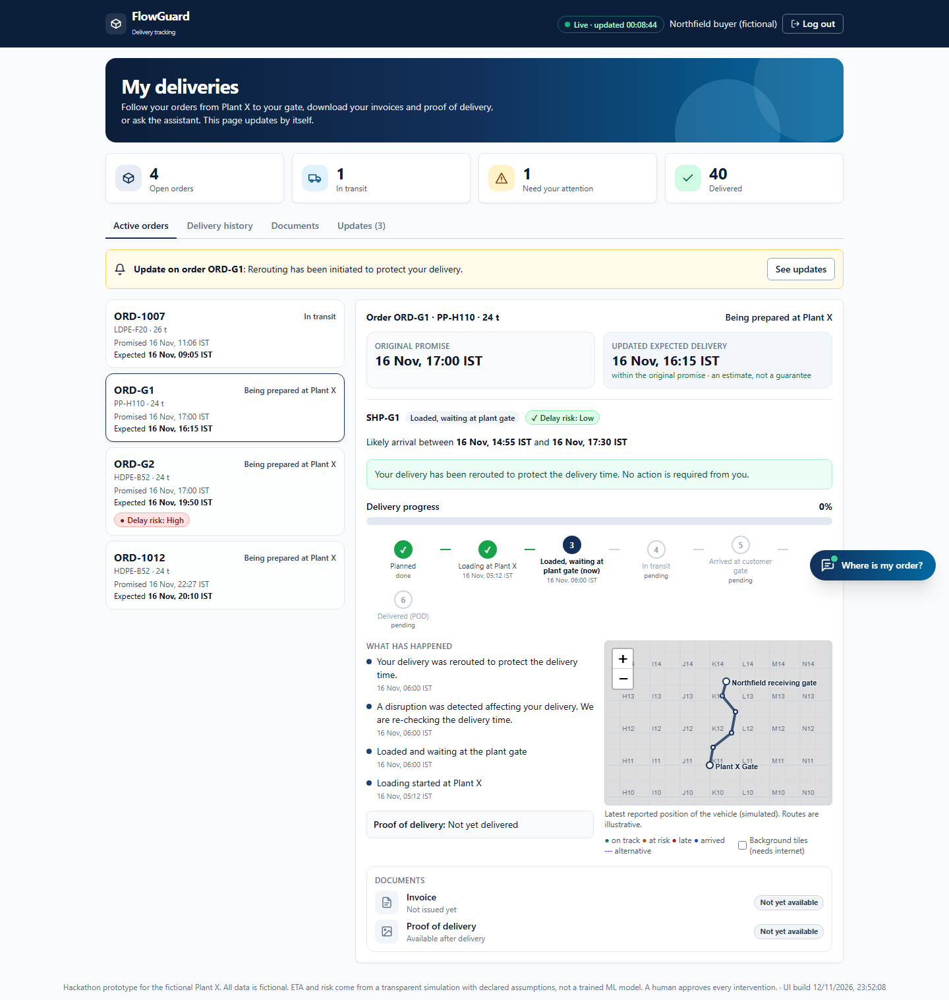
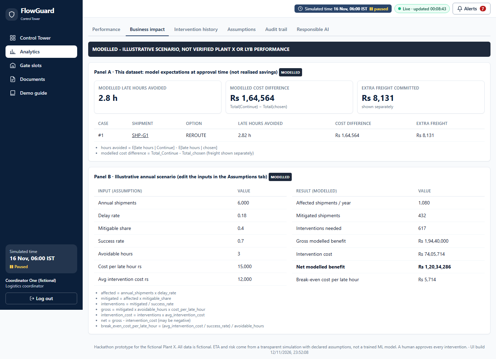

---

## 3. Example 2 — truck late at the plant, no alternative road → **Split**

*Demo guide → use case 4.* Shows that FlowGuard picks a **different** action when the situation is different.

**The situation.** **SHP-1013**: 20 t of caps material for Southbay Packaging on the **West Link**, which has
**no alternative road**. Planned to start loading at 07:00 IST. Promised **16:55 IST**. Southbay's stock runs
out at **16:00 IST**.

### Step 1 — Before

SHP-1013 "Planned": risk **LOW**, P(late) 0%, P(stock-out) 1%, ETA **13:54** (likely 13:14 – 14:47).

### Step 2 — The assigned truck will be 4 hours late

Coordinator → Simulation controls → **Late dispatch**, shipment **SHP-1013**, tick **Custom duration**, enter
**4 / 4 / 4** → Inject. (Or press **⏩ Jump** in the Demo guide.)

| | Before | After |
| --- | --- | --- |
| Risk | LOW (0) | **HIGH (98)** |
| P(late) | 0% | **97%** |
| P(stock-out) | 1% | **100%** |
| ETA (P50) | 13:54 | **17:54** — after the stock runs out at 16:00 |

### Step 3 — War Room

| Option | Feasible | ETA (P50) | P(late) | P(stock-out) | Extra freight | SLA | Stock-out cost | **Expected total** |
| --- | --- | --- | --- | --- | --- | --- | --- | --- |
| Continue | ✕ | 17:54 | 97% | 100% | Rs 0 | Rs 5,302 | Rs 1,48,595 | **Rs 1,53,897** |
| Reroute | — | *Not eligible: "No alternative route is defined for this route"* | | | | | | |
| **Split** | ✓ | 17:56 | 96% | **4%** | Rs 30,694 | Rs 3,647 | Rs 506 | **Rs 34,847** |

**RECOMMENDED: SPLIT** · **STABLE (16/16)**

> ETA: the urgent 6 t arrives at median **14:25 IST, 1.6 h before the customer's stock runs out**; the
> remaining 14 t follows at 17:56 IST.

The order as a whole is still late (P(late) 96%): the remaining 14 t waits for the late truck. But the
customer's **line keeps running** (stock-out risk 100% → 4%), which is what costs the money.

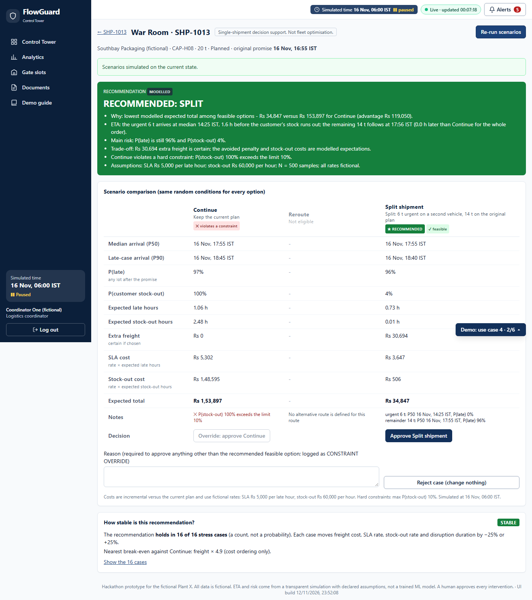

### Step 4 — Approve Split → what the system creates

| Lot | Quantity | Vehicle / driver | Loads at | ETA | Risk |
| --- | --- | --- | --- | --- | --- |
| SHP-1013 | 20 t | — | — | — | **SPLIT_PARENT**: not a delivery, excluded from KPIs |
| **SHP-1013-U** (urgent) | 6 t | Second vehicle, **Relief driver TR-1** (separate fictional driver) | 07:30 | **14:25** | LOW |
| **SHP-1013-R** (remainder) | 14 t | Original truck, Driver 13 | 11:00 (keeps its 4 h delay) | 17:56 | HIGH |

The two lots add up to exactly 20 t. The relief driver (`relief_tr1`) sees only SHP-1013-U. The customer
(`customer_c`) sees ORD-1013 as **two deliveries**: 6 t expected 14:25 and 14 t expected 17:56.

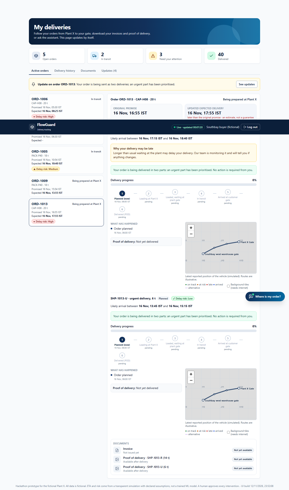

---

## 4. Same engine, different answers

| Situation | FlowGuard says | Why |
| --- | --- | --- |
| Flood + customer low on stock (Example 1) | **Reroute** | The bypass arrives before the stock runs out |
| Same flood + customer with 80 h of stock (use case 2) | **Continue — no justified intervention** | Late, but not costly: rerouting (Rs 8,564) costs more than the lateness (Rs 7,175) |
| Late truck + no alternative road (Example 2) | **Split** | Only a second truck can protect the customer's line |
| Rules too strict for any option (use case 3) | **No feasible option — escalate** | Nothing is recommended; a human must decide and write a reason |

---

## 5. Run these examples yourself

| How | Command / action |
| --- | --- |
| In the app (recommended for judges) | Coordinator → **Demo guide** → use case 1 or 4 → Start or Jump → follow the presenter panel |
| Re-record this file's numbers | `backend\.venv\Scripts\python scripts\record_flow.py` → `docs/flow_trace.md` |
| Automated browser run (takes the screenshots) | `cd frontend` → `npx playwright test` |
| Automated checks of every use case | `cd backend` → `.venv\Scripts\python -m pytest -q tests/test_demo_guide.py` |
