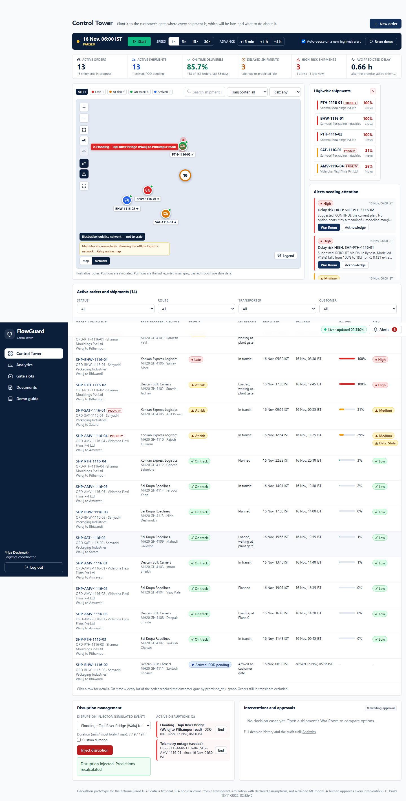
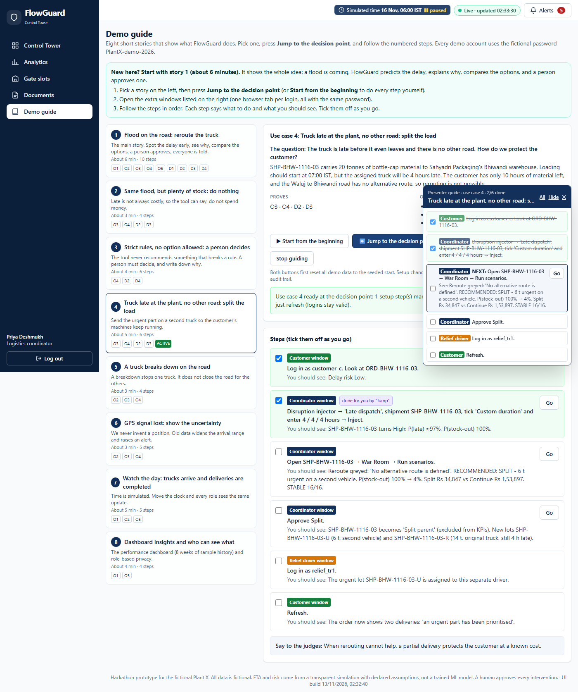

# FlowGuard — Order-to-Delivery Control Tower

> **Predict. Simulate. Deliver.**
> LYB Mumbai Hackathon 2026 · Round 2 · Problem Statement 3 (Supply Chain and Logistics)

FlowGuard is a web app that tracks bulk polymer orders from the plant to the customer, predicts delays before
they happen, and helps a logistics coordinator decide what to do about them.

> **Everything here is fictional.** "Plant X" is a made-up company from the hackathon brief. All data, routes,
> customers, transporters and costs are invented sample data. Nothing describes real LYB operations.



> **Presenting to judges?** Log in as `coordinator` and open **Demo guide** in the top menu: 8 ready-made
> use cases with one-click setup and a presenter panel that tells you the next step. See
> [section 6](#6-demo-guide-8-use-cases) and **[FLOW.md](FLOW.md)** (a real, recorded run of two examples).

---

## Contents

1. [Quick start (5 minutes)](#1-quick-start-5-minutes)
2. [Demo accounts](#2-demo-accounts)
3. [The problem in plain words](#3-the-problem-in-plain-words)
4. [What we built (O1–O5)](#4-what-we-built-o1o5)
5. [What makes FlowGuard different (D1–D4)](#5-what-makes-flowguard-different-d1d4)
6. [Demo guide: 8 use cases](#6-demo-guide-8-use-cases)
7. [Key ideas explained simply](#7-key-ideas-explained-simply)
8. [How it is built](#8-how-it-is-built)
9. [Folder structure](#9-folder-structure)
10. [Testing](#10-testing)
11. [Responsible AI, security and privacy](#11-responsible-ai-security-and-privacy)
12. [Documentation map](#12-documentation-map)
13. [Claude Code plugins in this project](#13-claude-code-plugins-in-this-project)
14. [How we are judged](#14-how-we-are-judged)
15. [Glossary](#15-glossary)

---

## 1. Quick start (5 minutes)

You need **Python 3.11** and **Node.js 18+**. Commands are for Windows (PowerShell or Git Bash).

### First time only

```bash
# Backend: create a virtual environment and install the pinned packages
cd backend
py -3.11 -m venv .venv
.venv\Scripts\python -m pip install -r requirements.lock.txt

# Frontend: install packages and build the production bundle
cd ../frontend
npm install
npm run build
```

### Every time

> **Why "my changes don't show up":** the server shows the *built* website (`frontend/dist`), and the Python server does
> not reload by itself. After changing code, **rebuild and restart**: just run `start-flowguard.cmd` (it does both).
> The footer shows the build time of the website you are looking at.

```bash
start-flowguard.cmd          # build + start   (add the word reset to also rebuild the demo data)
```

Or by hand:

```bash
cd backend
.venv\Scripts\python -m uvicorn app.main:app --port 8000 --workers 1
```

Open **http://127.0.0.1:8000** in your browser. The first start creates `backend/flowguard.db` and fills it
with the demo data automatically.

| Want to… | Do this |
| --- | --- |
| Start the demo again from the beginning | Control Tower → **Reset demo**, or `cd backend` then `.venv\Scripts\python -m app.seed.reset` |
| See the API documentation | http://127.0.0.1:8000/docs |
| Edit the frontend with live reload | Keep the backend running, then `cd frontend` and `npm run dev`, open http://localhost:5173 |

No internet, paid API or secret key is needed. The demo works with Wi-Fi off.

---

## 2. Demo accounts

All accounts are fictional. Password for every account: **`PlantX-demo-2026`**

| Username | Role | Sees |
| --- | --- | --- |
| `coordinator` (also `coordinator2`) | Logistics coordinator | Everything: Control Tower, War Room, Analytics |
| `customer_a` | Customer: Sharma Mouldings Pvt Ltd | Their own orders only (incl. the demo orders G1, G2) |
| `customer_b`, `customer_c` | Customers: Vidarbha Flexi Films Pvt Ltd, Sahyadri Packaging Industries | Their own orders only |
| `driver1` | Driver of SHP-PTH-1116-01 (main demo truck) | Their assigned shipment only |
| `driver2` … `driver14` | Drivers of the other live shipments | Their assigned shipment only |

**How names work.** The places are real Maharashtra towns on a fictional plant's network (Plant X, Waluj MIDC); the
companies and people are invented. Orders and shipments are named by *where they go, the date and a number*:
`ORD-PTH-1116-01` is order 1 to **P**i**TH**ampur on 16 Nov, and `SHP-PTH-1116-01` is its shipment. Codes:
`PTH` Pithampur, `AMV` Amravati, `SAT` Satara, `BHW` Bhiwandi. Drivers have names (`driver1` is Ramesh Patil,
`driver3` is Imran Shaikh, `driver11` is Santosh Bhosale); the login names stay `driver1`, `driver2` and so on.

**Finishing a delivery.** When a truck reaches the customer, the driver's card opens with *"You have arrived. Hand
over the delivery"*: type who received it, then upload a photo/signed note, or press *Complete delivery without a
document*. If the driver cannot, the coordinator does it from **Documents** (or the *Add proof of delivery* button
in the Control Tower table). It is recorded as done by the control tower, and the document can be added later.

**Tip:** each browser tab keeps its own login. Open three windows (or one normal + two private windows) to be
coordinator, customer and driver at the same time.

---

## 3. The problem in plain words

Plant X ships polymer in bulk trucks to business customers:

```
Planning  →  Dispatch (loading at the plant)  →  Transport (on the road)  →  Delivery
```

Today the customer and the sales team usually find out an order is late **only after it is already late**.

FlowGuard's idea: **tracking tells you where the truck is. FlowGuard tells you whether it matters and what to do.**

| User | Question FlowGuard answers |
| --- | --- |
| **Customer** | "Where is my order, and will it arrive on time?" |
| **Logistics coordinator** | "Which shipments are at risk, why, and should I intervene?" |
| **Driver** | "What is my next step?" (one button) |

---

## 4. What we built (O1–O5)

All five official requirements are built and tested. Full mapping: [docs/TRACEABILITY.md](docs/TRACEABILITY.md).

| ID | Official requirement | Where to see it |
| --- | --- | --- |
| **O1** | Separate logins for customer, coordinator, driver | Login page; each role gets different pages and data |
| **O2** | Map + status milestones | Control Tower map; milestone bar on every shipment, customer and driver page |
| **O3** | ETA, delay risk and the reason | Shipment Detail → "ETA intelligence" and reason chips |
| **O4** | Alert customer and coordinator with a suggested action | Alerts drawer ("Suggested action: REROUTE…"), customer "Delivery updates", War Room |
| **O5** | Dashboard: on-time and delay causes by route and transporter | Analytics → Performance |

Bonus ideas: proof of delivery is recorded (status + recipient name). Gate slot booking and the chatbot were not built.

---

## 5. What makes FlowGuard different (D1–D4)

| ID | Feature | One-line explanation |
| --- | --- | --- |
| **D1** | Probabilistic ETA engine | Simulates the trip 500 times, giving a range and a chance of being late, not one guess |
| **D2** | War Room | Compares **Continue / Reroute / Split** side by side, with costs, rules and a recommendation a human approves |
| **D3** | Customer stock cover | Being late only really hurts if the customer runs out of material; FlowGuard checks that |
| **D4** | Editable assumptions + stability | Change any cost or rule in the app; the War Room says whether its answer survives ±25% errors |

---

## 6. Demo guide: 8 use cases

The app has a built-in **Demo guide** (coordinator → top menu → **Demo guide**, or http://127.0.0.1:8000/demo).
For a step-by-step real run of use cases 1 and 4 with screenshots, read **[FLOW.md](FLOW.md)**.



### How to use it

1. Log in as `coordinator`. Click **Demo guide**.
2. Pick a use case on the left. Read the story and which windows to open (one login per window).
3. Press **▶ Start from the beginning** (you do every step live) or **⏩ Jump to the decision point** (the
   setup steps, such as the driver milestone or the disruption, are performed for you through the normal code
   and logged in the audit trail). Both first reset the demo data.
4. A **presenter panel** appears bottom-right on every coordinator page. It shows the **NEXT** step, which
   window to switch to (Coordinator / Customer / Driver, colour + label), what you should see, and a **Go**
   button. Tick steps as you go; **Hide** minimises it; **✕** stops guiding.
5. Other windows (customer, driver) only need a refresh after a setup; their logins stay valid.

### The 8 use cases

| # | Use case | Focus | What it proves | Answer FlowGuard gives |
| --- | --- | --- | --- | --- |
| 1 | Flood on the road, customer about to run out | SHP-PTH-1116-01 | O1–O5, D1–D4 (the main story) | **Reroute** via Dhule Bypass, STABLE 16/16 |
| 2 | Same flood, plenty of stock | SHP-PTH-1116-02 | Late is not the same as costly | **No justified intervention** (Continue Rs 7,175 < Reroute Rs 8,564) |
| 3 | Every option breaks a rule | SHP-PTH-1116-01 + strict rules | Hard rules, escalation, human override | **No feasible option – escalate**; CRITICAL alert; override needs a reason |
| 4 | Truck late at the plant, no alternative road | SHP-BHW-1116-03 | Split shipment | **Split**: 6 t urgent on a second truck; stock-out risk 100% → 4% |
| 5 | Truck breaks down on the road | SHP-AMV-1116-05 | Breakdown = vehicle stoppage, not a road closure | "Vehicle repair wait" +2.3 h; other trucks unaffected; Continue |
| 6 | Lost GPS signal | SHP-AMV-1116-04 | Honest uncertainty | Data **Stale**, faded marker at the last REPORTED position, wider range, alert |
| 7 | Watch the day unfold | Clock +6 h | Shared live view, proof of delivery | Trucks arrive; driver3 records POD; customer sees "Delivered"; KPIs update |
| 8 | Dashboard insights + privacy | Analytics, customer_b | O5 and role-based privacy | Waluj to Amravati congestion; Konkan Express weakest; customers see only their own data |

Extra accounts used by the use cases: `customer_b`, `customer_c`, `driver3`, `relief_tr1` (second-vehicle driver
for Sai Krupa Roadlines) and `coordinator2`.

### Navigation cheat-sheet

| I want to… | Go to |
| --- | --- |
| Start or switch a use case | Top menu → **Demo guide** |
| See all shipments, map, KPIs; inject a disruption; move the clock | Top menu → **Control Tower** |
| See why a shipment is late | Click its ID → **Shipment detail** (reason chips, "P50 moved…", history chart) |
| Compare Continue / Reroute / Split and approve | Shipment → **Open War Room** (or Alerts → Open War Room) |
| See warnings | **Alerts** button (top right, red count) |
| See the O5 dashboard, modelled impact, decision history, assumptions, audit, responsible AI | Top menu → **Analytics** (tabs) |
| Set a custom disruption length | Control Tower → Simulation controls → tick **Custom duration** |
| Reset everything | Control Tower → **Reset demo**, or any Demo guide button |

### Try the main story by hand (use case 1, without the guide)

This is scenario **G1**: a flood plus a customer who is low on stock. Takes about 4 minutes.

| Step | Tab | Do this | You should see |
| --- | --- | --- | --- |
| 1 | Coordinator | Log in as `coordinator`, press **Reset demo** | SHP-PTH-1116-01 "Loading at Plant X", risk **Low** |
| 2 | Customer | Log in as `customer_a` | Order ORD-PTH-1116-01, original promise 16 Nov 17:00 IST, "Delay risk: Low" |
| 3 | Driver | Log in as `driver1`, press **Confirm: Loaded, waiting at plant gate** | "Milestone recorded." |
| 4 | Coordinator | Refresh. Simulation controls → **Flooding - Tapi River Bridge (Waluj to Pithampur road)** → **Inject disruption** | SHP-PTH-1116-01 turns **High**, P(late) 100%, P(stock-out) 95% |
| 5 | Coordinator | Click **SHP-PTH-1116-01** | "P50 moved +5.4 h … flooding event", reason "Road closure wait" |
| 6 | Coordinator | **Alerts** → **Open War Room** → **Run scenarios** | **RECOMMENDED: REROUTE**, "holds in 16 of 16 stress cases" |
| 7 | Coordinator | **Approve Reroute** | "Reroute approved and applied" |
| 8 | Customer | Refresh | Original promise beside the updated expected delivery; "Rerouting has been initiated"; no costs shown |
| 9 | Driver | Refresh | "Route change approved: follow Dhule Bypass" |
| 10 | Coordinator | Analytics → Business impact, then Audit trail | Modelled benefit (labelled MODELLED); the approval in the audit log |

Two more stories to try:

- **G2 "late is not the same as costly"**: after step 4, open the War Room for **SHP-PTH-1116-02**. Same flood, but this
  customer has 80 hours of stock → **NO JUSTIFIED INTERVENTION – CONTINUE CURRENT PLAN**.
- **G3 "no feasible option"**: Analytics → Assumptions, set `alpha` to `0.01` and `max_incremental_freight_rs`
  to `20000`, save, then run the SHP-PTH-1116-01 War Room → **NO FEASIBLE OPTION – ESCALATE**, and a CRITICAL alert.

The full presentation script, slides outline and Q&A drill: [docs/DEMO_RUNBOOK.md](docs/DEMO_RUNBOOK.md).

---

## 7. Key ideas explained simply

### 7.1 Shipment milestones

A shipment only moves forward, one step at a time:

```
PLANNED → LOADING → AT_PLANT_GATE → IN_TRANSIT → ARRIVED_AT_CUSTOMER_GATE → DELIVERED
```

- `AT_PLANT_GATE` = loaded, waiting to leave Plant X.
- `ARRIVED_AT_CUSTOMER_GATE` = at the customer's gate. **This moment decides on time or late.**
- `DELIVERED` = proof of delivery signed afterwards.
- A split order's original shipment becomes `SPLIT_PARENT`: not a delivery, excluded from KPIs.

### 7.2 How the ETA is predicted (Monte Carlo simulation)

We don't know exactly how long the rest of the trip will take, so we simulate it **500 times**, each time with
slightly different (random but realistic) loading, queue, traffic and flood durations:

```
arrival = now + remaining loading + gate queue + Σ (segment km ÷ speed × trip factor × segment factor)
              + closure waits + repair wait
```

| Output | Meaning |
| --- | --- |
| **P50** | Median: half of the 500 simulated trips arrive before this time |
| **P10 – P90** | 80% of simulated trips arrive inside this range |
| **P(late)** | Share of trips that arrive after the promised time |

> This is a transparent simulation with stated assumptions. It is **not** a trained machine-learning model
> and makes no claim of real-world accuracy.

### 7.3 Reason chips

Each chip shows how many hours one cause adds **on average** (handling, gate queue, slowdown, road closure,
vehicle repair). A last "travel variability" chip makes them add up exactly. When a prediction changes,
FlowGuard says why: *"P50 moved +5.4 h since 06:00: flooding event DSR-001."*

### 7.4 Stock cover

```
stock runs out at   = time measured + inventory ÷ consumption rate
usable arrival      = truck arrival + unloading time
stock-out hours     = how long the usable arrival is after the stock runs out (0 if before)
```
With two lots (split), the first lot to arrive refills the stock first.

### 7.5 Risk index

```
risk index = 100 × (0.6 × P(late) + 0.4 × P(stock-out))
```

| Band | Score | Also forced to this level when… |
| --- | --- | --- |
| LOW | 0–29 | |
| MEDIUM | 30–59 | P(late) ≥ 25% |
| HIGH | 60–100 | P(late) ≥ 50% or P(stock-out) ≥ 30% |

It is a ranking score, not a probability. The weights are editable.

### 7.6 The War Room

| Option | Meaning | Allowed when |
| --- | --- | --- |
| **Continue** | Keep the current plan | Always |
| **Reroute** | Take the alternative road | The truck has not passed the turn-off (decision node) |
| **Split** | Send an urgent part on a second truck | The truck has not left the plant |

```
expected total = extra freight + SLA penalty rate × expected late hours + stock-out rate × expected stock-out hours
```

- The cheapest option that breaks **no hard rule** is recommended (rule example: P(stock-out) ≤ 10%).
- If nothing beats Continue by a meaningful margin → **"No justified intervention"**.
- If every option breaks a rule → **"No feasible option — escalate"**, and nothing is recommended.
- **A human always approves or rejects.** Choosing anything else needs a written reason, logged as
  `CONSTRAINT OVERRIDE`.

### 7.7 Stability check

The comparison is repeated 16 times with freight cost, SLA rate, stock-out rate and flood duration each
25% lower or higher.

| Label | Same answer in |
| --- | --- |
| STABLE | 16 of 16 cases |
| SENSITIVE | 8–15 cases |
| NO ROBUST RECOMMENDATION | fewer than 8 |

### 7.8 Truth versus prediction

The demo has a hidden simulator that decides what "really" happens to each truck (it is what moves trucks when
you advance the clock). The prediction engine is **never** allowed to see it, so predictions use only what a
real control tower could observe. A test enforces this.

### 7.9 Approval safety

A War Room result is only valid for the situation it was calculated on. If the shipment changes, the
assumptions are edited, or the clock moves before approval, the server refuses (HTTP 409) and asks you to
re-run the scenarios.

---

## 7A. Live operations and the three bonus features

### Live operations (all three portals share one backend and update by themselves)

- **No refresh needed.** Every open screen checks one tiny endpoint (`/api/sync/state`, a hashed change-stamp) every
  2.5 s and reloads its data only when something changed. The header shows `Live · updated hh:mm:ss`.
- **Simulation control** (coordinator): Start / Pause, speed (1×, 5×, 15×, 30× simulated minutes per real second),
  advance by hand, auto-pause on a new high-risk alert, reset. The clock is **paused by default**.
- **New order** (coordinator): creates an order and assigns a transporter, a free driver and a vehicle. The driver can
  log in at once (spare drivers `driver15`, `driver16`, `driver17`).
- **Driver app**: milestone buttons, report a breakdown or road hazard (becomes a real disruption), history.
- **Live activity feed**: milestones, assignments, position updates, disruptions, risk changes, alerts, customer
  notifications, approvals, gate and document events. Every line is a stored record.

### Bonus 1 · Truck slot booking at the Plant X gate (coordinator **Gate slots**, driver app)

| What | How it works |
| --- | --- |
| Slots | Hourly, 5 days around the simulated "today", each with a capacity (default 3, editable per slot) |
| States | Open, Full, Overbooked (capacity lowered below the bookings), Unavailable (closed), Past |
| Coordinator | Book a shipment + vehicle + driver, reschedule, cancel, mark completed, edit capacity / close a slot, upcoming and history lists |
| Rules | No booking beyond capacity, no second active booking per shipment, no past or closed slots, reschedule releases the old place and takes the new one in one step, cancel releases capacity |
| Lifecycle (separate from the shipment) | `BOOKED → CHECKED_IN → COMPLETED`, plus `CANCELLED` and `MISSED` |
| Driver | Sees the appointment, gate details and instructions; **Check in** opens 60 simulated minutes before the slot |
| Automatic | Departure from Plant X completes the booking; an unused booking whose slot ended becomes MISSED (capacity released) |
| Time | Always the **simulation clock** (IST display). Never the real clock |
| Audit | Every create / reschedule / cancel / check-in / completion / missed / slot change |

### Bonus 2 · "Where is my order?" chatbot (customer portal, button bottom-right)

Rule-based and read-only: **no language model**. It classifies the question into an intent and builds the answer from the
same customer-safe records the portal shows, so it cannot invent a position or ETA, cannot see other customers' orders
and cannot reveal costs. If something is unknown it says so. It answers: where is my order (nearest route point, % of the
route, **timestamp of the last reported position**), status, dispatch, ETA range, original promise, updated expected
delivery, reached the customer gate, why delayed (+ a next step), proof of delivery, invoice. Another customer's order
returns the same "could not find" answer as a non-existent one.

### Bonus 3 · Invoices and proof of delivery (coordinator **Documents**, order page, driver app, customer **Documents** tab)

| Who | Can |
| --- | --- |
| Coordinator | Upload an invoice; replace it with a new audited version (reason required); download; see POD status; download and **verify** a POD |
| Driver | After reaching the customer gate: recipient name + signed note or photo; this completes the delivery (delivered time = simulation clock); can replace the document |
| Customer | See and download only **their own current** invoice and POD; see availability on each order |

Security: PDF / JPG / JPEG / PNG only; the type is decided from the **file content**; 10 MB limit (configurable,
`FLOWGUARD_MAX_UPLOAD_MB`); sanitised display names and random stored names (no path traversal); files live in
**private** storage (`backend/storage/documents`), never served as static files; every download goes through an
ownership-checked endpoint (someone else's document is a 404); uploads, replacements, verifications and downloads are
audited. Fictional sample files to upload: `docs/demo_files/`.

### New accounts and addresses

| Page | URL | Who |
| --- | --- | --- |
| Control Tower | http://127.0.0.1:8000/tower | `coordinator` |
| Gate slot booking | http://127.0.0.1:8000/gate | `coordinator` |
| Documents | http://127.0.0.1:8000/documents | `coordinator` |
| Driver app | http://127.0.0.1:8000/driver | `driver1` (gate appointment), `driver11` (proof of delivery), `driver14` (breakdown) |
| Customer portal + chat + documents | http://127.0.0.1:8000/customer | `customer_a`, `customer_b`, `customer_c` |

Password for every account: `PlantX-demo-2026`. Spare drivers for new orders: `driver15`, `driver16`, `driver17`.

---

### 7B. The redesigned Control Tower and map

- **Map first.** The Control Tower puts the live map in the centre with a sidebar (high-risk shipments, alerts, gate slots, live activity). The simulation controls are one slim toolbar; the simulated time is shown once.
- **Two map backgrounds.** *Map* uses OpenStreetMap tiles when you are online (free, no key, attribution shown at the bottom right). If tiles cannot load, or you are offline, it switches to *Network*: a local drawing of the routes, labelled **"Illustrative logistics network - not to scale"**. You can switch by hand and press *Retry online map*.
- **Reading the map.** Truck discs are green (on track), amber (at risk), red (late), blue (arrived, POD pending) or grey with a dashed ring (stale position). The small dot on a truck shows how fresh its last report is. Numbered discs group trucks that are close together; click one to zoom in or fan them out. Solid navy lines are the main roads, dashed violet lines are alternatives, a solid violet line is an **approved reroute** that is now in use, and red marks a road disruption. The **Legend** button explains every symbol.
- **Tools.** Zoom, fit all, centre on Plant X, centre on the selected shipment, full screen (Esc to leave), show/hide alternatives and disruptions, filter by status, risk and transporter, and search by shipment ID. Click a truck for its details and the buttons to open the shipment or its War Room.
- **Offline demo.** Nothing else needs the internet. The browser tests block the map tiles on purpose to prove the whole workflow still works.

---

## 8. How it is built



| Layer | Choice | Why |
| --- | --- | --- |
| Backend | Python 3.11, FastAPI, SQLAlchemy, Pydantic | Fast to build; typed API contracts |
| Database | SQLite (WAL mode, foreign keys on) | No server to install; works offline |
| Engine | NumPy | Vectorised Monte Carlo (500 samples in milliseconds) |
| Auth | JWT (HS256, 60 min) + Argon2 password hashing | Three roles, checked on every request |
| Frontend | React 18, Vite, TypeScript, Tailwind | Standard, fast; types generated from the API |
| Charts / map | Recharts, Leaflet (vector shapes on an offline grid) | No map tiles needed |
| Tests | pytest, Playwright | 217 backend tests, 15 browser tests (+ 3 live-site checks) |

One server serves both the API and the built website, from the same address.
More detail: [docs/ARCHITECTURE.md](docs/ARCHITECTURE.md).

---

## 9. Folder structure

```
LYB/
├── README.md                 This file
├── CLAUDE.md                 Rules Claude Code reads every session
├── PROGRESS.md               Done / next / blockers
├── FLOW.md                   A real recorded run of two use cases, step by step
├── start-flowguard.cmd       Builds the website and starts the server (avoids a stale build)
├── .claude/settings.json     Claude Code plugins enabled for this project
├── backend/
│   ├── app/
│   │   ├── engine/           Pure maths: ETA (eta.py), stock, risk, War Room. NumPy only
│   │   ├── services/         Business logic: mapping, predictions, alerts, War Room, analytics
│   │   ├── simulator/        Hidden "truth" + simulation clock (engine never imports this)
│   │   ├── api/              HTTP endpoints (public.py, coordinator.py)
│   │   ├── seed/             Fictional network + one-command reset
│   │   ├── models.py         Database tables
│   │   ├── schemas.py        API contracts (Pydantic)
│   │   ├── security.py       Login, tokens, role and ownership checks
│   │   └── assumptions.py    Every editable assumption with its limits
│   ├── tests/                217 pytest tests
│   └── requirements.lock.txt Pinned Python packages
├── frontend/
│   ├── src/pages/            The 7 views + Demo guide
│   ├── src/components/       Map, layout, shared UI
│   ├── src/api/              API client + generated types (schema.d.ts)
│   └── e2e/                  Playwright end-to-end test
├── contracts/                openapi.json (generated) + fixtures (real responses)
├── scripts/                  Hand-check, OpenAPI export, doc generator, diagram renderer
└── docs/                     Everything else (see section 12)
```

---

## 10. Testing

| What | Command | Result on 2026-11-12 |
| --- | --- | --- |
| Backend tests | `cd backend` → `.venv\Scripts\python -m pytest -q` | 217 passed |
| Golden scenarios only | `.venv\Scripts\python -m pytest -q tests/test_golden.py` | 4 passed |
| Phase 0 hand-check (no database) | `backend\.venv\Scripts\python scripts\phase0_handcheck.py` | ALL TARGETS COMPATIBLE – GO |
| Frontend type-check + build | `cd frontend` → `npm run build` | OK |
| End-to-end (3 browsers, production build, offline check) | `cd frontend` → `npx playwright test` (first time: `npx playwright install chromium`) | 12 passed |
| Check the RUNNING site (read-only, all 3 roles) | start the server, then `cd frontend` → `npx playwright test -c playwright.live.config.ts` | 3 passed |

After changing an API schema: `backend\.venv\Scripts\python scripts\export_openapi.py`, then in `frontend/`
run `npm run types`. A test fails if the exported contract is stale.

---

## 11. Responsible AI, security and privacy

| Control | How |
| --- | --- |
| No runtime generative AI | ETA and risk come from a transparent simulation; decisions from readable rules |
| Confidence | Every prediction shows a range, a probability and a data-confidence label (Fresh / Aging / Stale) |
| Human approval | Nothing changes a shipment until a coordinator approves; overrides need a reason |
| Freshness | Approval refused (409) if the shipment, assumptions or clock changed |
| Access | Role and ownership checked on every request; others' records return 404 |
| Privacy | Customers get separate response shapes with no costs, penalties or other customers' data (tested) |
| Audit | Append-only log of every decision, with simulated and real time |
| Honesty | Every money figure from assumptions is labelled **MODELLED** |

Generative AI **was** used to help build this project and is declared in
[docs/AI_DISCLOSURE.md](docs/AI_DISCLOSURE.md) (hackathon rule 5: undeclared use costs 10 points).
Limitations: [docs/KNOWN_LIMITATIONS.md](docs/KNOWN_LIMITATIONS.md).

---

## 12. Documentation map

Suggested reading order for a new team member: **FLOW.md → walkthroughs → your defence brief → runbook**.

| Document | Read it to… |
| --- | --- |
| [FLOW.md](FLOW.md) | See the system actually running: two use cases traced click by click, with real numbers |
| [docs/walkthroughs/](docs/walkthroughs/) | Understand each build phase in plain language (with self-check questions) |
| [docs/DEFENCE_BRIEF_DEV1.md](docs/DEFENCE_BRIEF_DEV1.md) / [DEV2](docs/DEFENCE_BRIEF_DEV2.md) / [DEV3](docs/DEFENCE_BRIEF_DEV3.md) | Prepare for judges' questions on your module |
| [docs/DEMO_RUNBOOK.md](docs/DEMO_RUNBOOK.md) | Run the 10-minute presentation, reset checklist, slides outline, Q&A |
| [docs/source/requirements.md](docs/source/requirements.md) | Read the official requirements (verbatim, with page numbers) |
| [docs/TRACEABILITY.md](docs/TRACEABILITY.md) | See where each requirement is built and tested |
| [docs/ASSUMPTIONS.md](docs/ASSUMPTIONS.md) | Find every invented number and why |
| [docs/GOLDEN_SCENARIO.md](docs/GOLDEN_SCENARIO.md) / [GOLDEN_BASELINE.md](docs/GOLDEN_BASELINE.md) | Demo stories, targets, measured results |
| [docs/spec/](docs/spec/) | Engine, API, UI and QA specifications as built |
| [docs/API_ACCESS_MATRIX.md](docs/API_ACCESS_MATRIX.md) / [DB_REFERENCE.md](docs/DB_REFERENCE.md) | Generated reference (who can call what; every table) |
| [docs/FINAL_AUDIT.md](docs/FINAL_AUDIT.md) | Evidence for every requirement and the remaining to-dos |
| [docs/screenshots/](docs/screenshots/) | Screens captured by the end-to-end test |

---

## 13. Claude Code plugins in this project

Seven plugins from the official Anthropic marketplace are enabled in [.claude/settings.json](.claude/settings.json).
Restart Claude Code (or reload the VS Code window) after cloning so the commands appear; `/plugin` lists them.

| Plugin | What it gives you | How to use it |
| --- | --- | --- |
| **feature-dev** | Guided workflow for one feature: explore → design → build → review | `/feature-dev <what to build>` |
| **code-review** | Several reviewer agents check a pull request | `/code-review` |
| **pr-review-toolkit** | Specialist reviewers: tests, silent failures, comments, types, simplification | `/review-pr` |
| **hookify** | Turns "never do X" rules into automatic guards | `/hookify <rule>`, `/hookify:list` |
| **skill-creator** | Creates and tests reusable skills | Ask: "create a skill for …" |
| **claude-code-setup** | Recommends hooks, skills and subagents for this repo | Ask: "recommend automations for this project" |
| **ralph-loop** | Repeats a prompt until a task is finished | `/ralph-loop "<prompt>" --max-iterations N`, stop with `/cancel-ralph` |

Good uses here: `/hookify warn when backend/app code calls datetime.now()`; `/review-pr` before merging;
"create a skill that resets the demo and runs the golden tests".

Notes: ralph-loop needs `jq` (`winget install jqlang.jq`); always give it `--max-iterations`. These plugins are
generative-AI tools; if you use them, add a row to `docs/AI_DISCLOSURE.md`.

---

## 14. How we are judged

| # | Criterion | Points |
| --- | --- | --- |
| 1 | Problem understanding and user fit | 10 |
| 2 | Innovation and original thinking | 10 |
| 3 | **Working prototype / functionality** | **20** |
| 4 | Technical design and architecture | 10 |
| 5 | Feasibility and scalability | 10 |
| 6 | **Business / user value and impact** | **15** |
| 7 | Responsible AI, security and data | 10 |
| 8 | User experience and accessibility | 5 |
| 9 | Presentation and demo | 5 |
| 10 | Q&A and team understanding | 5 |

10 minutes: ~2 problem and approach · ~4 live demo · ~2 defend · ~2 judges' Q&A.

**Before presenting** (from [docs/FINAL_AUDIT.md](docs/FINAL_AUDIT.md)): every member reads their brief and signs
the AI disclosure; add any other AI tools used; make slides; rehearse five times; record a backup video.

---

## 15. Glossary

| Term | Meaning |
| --- | --- |
| **ETA** | Estimated time of arrival |
| **P50 / P90** | Time by which 50% / 90% of simulated trips have arrived |
| **P(late)** | Chance of arriving after the promised time |
| **Monte Carlo** | Running a calculation many times with random inputs to see the range of outcomes |
| **promised_at** | Delivery deadline promised to the customer; never changes |
| **Updated expected delivery** | FlowGuard's current median estimate; an estimate, not a new promise |
| **SLA** | Service level agreement; here, a penalty per late hour |
| **Stock cover** | How long the customer's inventory lasts |
| **Lot** | One truckload of an order; a split order has an URGENT and a REMAINDER lot |
| **Decision node** | The last point where a truck can still turn onto the alternative road |
| **Common random numbers** | Using the same random draws for every option so differences are fair |
| **Hard constraint** | A rule an option must not break to be recommended (e.g. P(stock-out) ≤ 10%) |
| **Override** | Approving an option that is not the recommended one; needs a reason |
| **POD** | Proof of delivery |
| **RBAC** | Role-based access control: what each login may see and do |
| **Telemetry** | Position reports from the truck; "Stale" means none recently |
| **MODELLED** | Label for any figure that comes from our assumptions, not real results |
