# Architecture

Source: [`architecture.mmd`](architecture.mmd). Re-render offline with `node ../scripts/render_diagram.mjs`
(run from `frontend/`). The diagram matches the running system: every box is a real folder.

## One request, end to end

1. The browser sends a JSON request with the role's JWT (`frontend/src/api/client.ts`).
2. `backend/app/security.py` decodes the token, **re-reads the user's role and active flag from the
   database**, checks the role (403) and, for a specific shipment or alert, ownership (404).
3. A router in `backend/app/api/` validates the body with a Pydantic schema (`schemas.py`).
4. A service in `backend/app/services/` does the work:
   - `mapping.py` turns database rows into `EngineInputs` using only **observed** data (last reported
     position, recorded milestones, active disruptions, declared distributions).
   - `engine/eta.py::simulate_arrival` runs the Monte Carlo; `engine/stock.py`, `risk.py`, `warroom.py`
     turn samples into probabilities, risk, costs and a recommendation.
   - `predictions.py` stores the result as an immutable row; `alerts.py` decides whether to alert.
5. The response is built from schemas; customers get separate allow-list schemas.

## Truth versus belief

The demo needs "what really happens" so the clock can move trucks. That lives in `backend/app/simulator/`:
hidden durations and travel factors are derived from `seed_truth` and **never stored**. The simulator writes
only what a real control tower would observe: milestones, a reported position each 5-minute tick (unless a
telemetry outage is active), and disruption end times. The engine and the mapping layer never import the
simulator; a test scans the imports.

## Folder map

| Path | What it is |
| --- | --- |
| `backend/app/engine/` | Pure maths. NumPy only. No database, no web framework |
| `backend/app/services/` | Business logic that reads/writes the database |
| `backend/app/simulator/` | Hidden truth + simulation clock |
| `backend/app/api/` | HTTP endpoints (`public.py`: auth, customer, transporter; `coordinator.py`: everything else) |
| `backend/app/seed/` | Fictional network (`network.py`) and deterministic reset (`reset.py`) |
| `backend/tests/` | 126 pytest tests |
| `frontend/src/pages/` | The seven views |
| `frontend/src/api/schema.d.ts` | Types generated from `contracts/openapi.json` |
| `frontend/e2e/` | Playwright end-to-end test |
| `contracts/` | `openapi.json` (generated) and `fixtures/` (real responses) |
| `scripts/` | Hand-check, OpenAPI export, reference-doc generator, diagram renderer |

## Key design decisions

| Decision | Why | Trade-off |
| --- | --- | --- |
| Monte Carlo simulation, not a trained ML model | No real telemetry history exists; training on our own synthetic data would be circular. A simulation is explainable line by line | Accuracy depends on the declared distributions, which are assumptions |
| One engine function for ETA, risk and all options | The War Room "Continue" equals the live prediction; no two models disagreeing | — |
| Common random numbers | Option differences reflect the option, not sampling noise | Needs careful column naming |
| Predictions stored, GETs never simulate | Fast pages, an audit history of every prediction and why it changed | Must recompute on every material event |
| SQLite + one worker | Zero install, offline, deterministic | Not for many concurrent writers; a pilot would move to PostgreSQL |
| Version snapshots on approval | A decision is only valid for the state it was simulated on | The demo clock must be paused while deciding |
| Customer allow-list schemas | Privacy by construction, tested by key absence | Two schemas to maintain |
